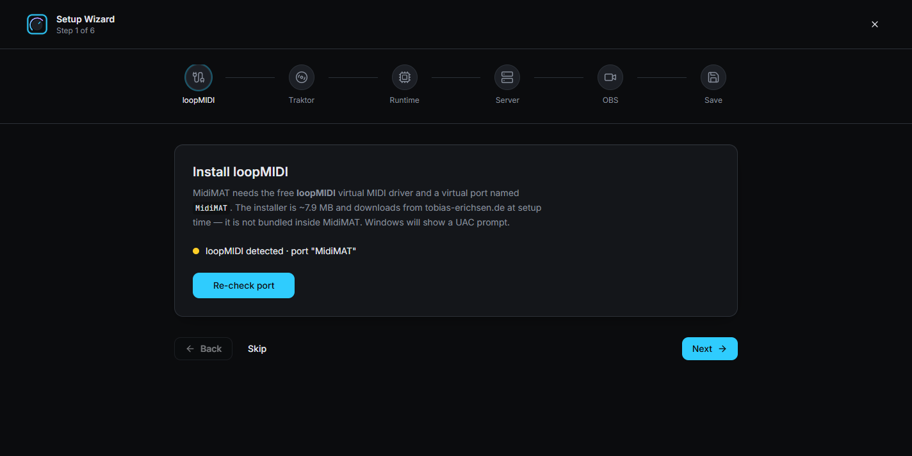
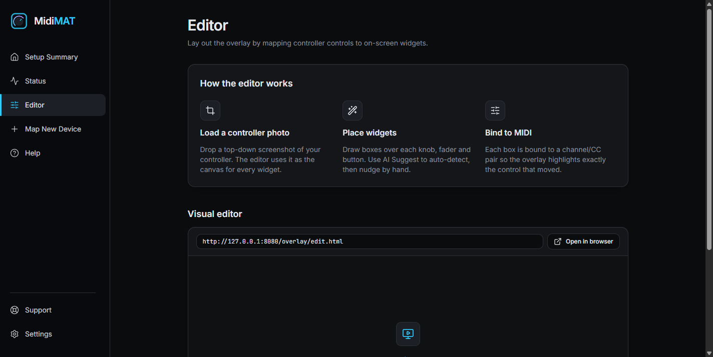

<div align="center">

# MidiMAT

**Your DJ set, annotated live.**

MidiMAT watches your Traktor controller and draws a glowing highlight around the
matching control in your stream — so viewers can *see* every knob turn, fader move
and button press as it happens.

Built for **[OBS Studio](https://obsproject.com/)** and **[Streamlabs Desktop](https://streamlabs.com/desktop)** —
both ship a **Browser Source**, which is all MidiMAT needs. No plugin, no capture-card
tricks, no per-frame video processing.

[](#requirements)
[](#streaming-setup--obs-studio-or-streamlabs-desktop)
[](https://www.python.org/)
[](#license)

<!-- Screenshot/demo GIF goes here — see docs/images/README.md -->
<!--  -->

</div>

---

## What it does

During a live set, the action on your controller is invisible to the viewer — they
hear a filter sweep but can't see your hand on the knob. MidiMAT fixes that by
compositing a subtle glow over the exact widget you're touching, in real time
(< 50 ms), plus an optional on-screen card naming the control and its value.

```
  Traktor KONTROL ──USB──▶ MidiMAT sidecar ──WebSocket──▶ overlay ──▶ Browser Source
     (X1 / Z1 / F1)          MIDI → function →            (glow +      (OBS / Streamlabs,
                             screen coordinates            label)       transparent layer)
```

No OBS plugin, no capture-card tricks — the overlay is a plain web page rendered by the
built-in **Browser Source** in **OBS Studio** or **Streamlabs Desktop**.

## How it works (and why it's fast)

The tempting approach — run a vision model on the video feed — is 200–1000 ms slow
and GPU-hungry. MidiMAT splits the problem instead:

| Question | Answer | Cost |
|---|---|---|
| *Which function does this MIDI signal control?* | Traktor's mapping, resolved from a lookup table | once, deterministic |
| *Where is that widget on screen?* | A saved layout (placed once in the built-in editor) | once, then cached |

A vision model is used **only as a bootstrapper** (optional auto-placement), never in
the per-frame path. That's what keeps the overlay responsive during a set.

## Features

- **Real-time glow overlay** — rounded-rect or circular highlight, deck-coloured
  (A cyan · B green · C violet · D orange · FX amber), decaying ~600 ms after input.
- **HUD card** — shows the control's name and live value; works even for controls
  that have no on-screen widget (e.g. "track loaded", browser commands).
- **Visual editor** — drop a screenshot of Traktor in, drag boxes onto the controls,
  save. `🎯 Detect & re-fit` re-aligns everything when you move or resize the window.
- **Guided mapping wizard** — walks you through each out-mapping in Traktor's
  Controller Manager and verifies the signal actually arrives.
- **Works with NI hardware** — X1 MK3, Z1 MK2, F1 (and any class-compliant MIDI
  controller via a virtual MIDI port).
- **Optional AI placement** — the built-in OpenCV detector needs nothing extra; an
  optional trained YOLO detector is more accurate. See `requirements-vision.txt`.

## Requirements

| | |
|---|---|
| **OS** | Windows 10 (1809+) or Windows 11 |
| **DJ software** | Traktor Pro 3 / 4 |
| **MIDI bridge** | [loopMIDI](https://www.tobias-erichsen.de/software/loopmidi.html) (virtual MIDI port) |
| **Streaming** | **OBS Studio** or **Streamlabs Desktop** — either works; both have a Browser Source |
| **Controller** | A Traktor KONTROL device, or any MIDI controller |

> **macOS / Linux:** not supported yet. The overlay and sidecar are portable, but the
> virtual-MIDI bridge differs per platform.

## Getting started

Launch MidiMAT and the **Setup Wizard** opens on first run. It checks your machine and
walks you through each piece — nothing to type, and nothing gets installed without your
say-so.



1. **loopMIDI** — detected automatically; if it's missing, the wizard downloads the
   official installer from the vendor (Windows shows a UAC prompt) and creates a virtual
   port named `MidiMAT`.
2. **Traktor** — finds your `Traktor Settings.tsi` and points the `Generic MIDI`
   out-port at `MidiMAT`. It edits the file surgically: every other controller and
   mapping is left byte-for-byte alone, a timestamped backup is made first, and it
   refuses to touch the file while Traktor is running.
3. **Server** — starts MidiMAT's local server. No Python to install; the runtime ships
   inside the app.
4. **OBS / Streamlabs** — detects your setup and shows the Browser Source settings.
5. **Save** — remembers the result, so later launches skip straight to the app.

Then place your widgets in the **Editor**: drop in a screenshot of Traktor, drag a box
onto each control, and hit Save. If you later move or resize the Traktor window,
`🎯 Detect & re-fit` moves everything back onto the controls.



The sidebar covers the rest:

| Screen | What it's for |
|---|---|
| **Setup Summary** | where each piece stands — re-run setup here if something drifts |
| **Status** | server health, a live MIDI log, and the demo / native-HID / auto-start switches |
| **Editor** | place the glow boxes on your Traktor layout |
| **Map New Device** | learn a controller that isn't mapped yet |
| **Help** | everything in one screen |

Finally, add the overlay to your stream — see
[Streaming setup](#streaming-setup--obs-studio-or-streamlabs-desktop) below.

### Running from source (developers)

Until the desktop installer is published, contributors can run the stack directly:

```powershell
git clone https://github.com/jardaKarlik/MidiMAT.git
cd MidiMAT
.\scripts\run.ps1
```

`run.ps1` creates the virtual environment, installs dependencies, and starts:

- **Overlay** — <http://127.0.0.1:8080/overlay/index.html>
- **Editor** — <http://127.0.0.1:8080/overlay/edit.html>
- **WebSocket** — `ws://127.0.0.1:8787`

No hardware? Open the overlay in demo mode — it animates on its own:

```
http://127.0.0.1:8080/overlay/index.html?demo=1
```

To learn a controller from the command line (what the Setup Wizard automates for you):

```powershell
.\.venv\Scripts\python.exe scripts\setup_wizard.py --profile z1
.\scripts\run.ps1 --midi --no-demo
```

### Streaming setup — OBS Studio **or** Streamlabs Desktop

Both apps use the **same** source types and settings; the menus differ only slightly.

1. Add a **Window Capture** (or Display Capture) of Traktor; crop to the Traktor window.
2. Add a **Browser Source** on top:
   - **URL:** `http://127.0.0.1:8080/overlay/index.html`
   - **Width / Height:** match your canvas (the default layout targets 1920×1080)
   - ✅ *Refresh browser when scene becomes active*
   - ⬜ *Shutdown source when not visible* (leave **off**)
3. Make the editor's screenshot region identical to the crop rectangle.

The overlay background is transparent, so only the glow composites over your capture.

> **Streamlabs Desktop:** same steps — *Add Source → Browser Source*. Where OBS puts
> "Shutdown source when not visible" under the source's properties, Streamlabs keeps it
> in the same panel; either way, leave it **off**.

## Repository layout

```
MidiMAT/
├── sidecar/            Python service: MIDI in → resolve → WebSocket out
│   ├── server.py       HTTP static host + WebSocket broadcaster
│   ├── midi_tap.py     MIDI port listening (mido / python-rtmidi)
│   ├── tsi_parser.py   Traktor .tsi mapping parser
│   ├── mapping.py      MIDI key → Traktor function resolver
│   ├── suggest.py      Optional AI/OpenCV auto-placement
│   └── calibrate.py    Manual widget-box calibration helper
├── overlay/            The OBS Browser Source page
│   ├── index.html      transparent canvas (glow + HUD)
│   ├── edit.html       visual box-placement editor
│   └── overlay.js      WebSocket client + renderer
├── ui/                 Desktop app management UI (React + Tailwind)
├── app/                Desktop app shell (WinUI 3 / Windows App SDK)  ← in progress
├── scripts/            Setup wizard, map builder, tests
├── docs/               Architecture and protocol notes
├── mapping/controls.csv   Source of truth: one row per mapped control
├── cc_map.json         Generated: MIDI key → control
└── layout.json         Generated: control → screen box
```

## Documentation

- [`docs/ARCHITECTURE.md`](docs/ARCHITECTURE.md) — components, data flow, latency budget
- [`docs/TRAKTOR_UI.md`](docs/TRAKTOR_UI.md) — Traktor GUI zone map + HUD placement
- [`docs/PHASE1.md`](docs/PHASE1.md) — real-MIDI bring-up notes
- [`docs/NHL_PROTOCOL.md`](docs/NHL_PROTOCOL.md) — native HID research (future direct-HID input)
- [`docs/DESIGN_APP.md`](docs/DESIGN_APP.md) — desktop app design

## Project status

| Area | State |
|---|---|
| Glow overlay + HUD in OBS Studio / Streamlabs Desktop | ✅ working |
| Real MIDI input + Traktor mapping resolution | ✅ working |
| Visual editor + auto re-fit | ✅ working |
| Guided mapping wizard | ✅ working |
| Desktop app (installable, single EXE) | 🚧 in development |
| Direct-HID input (drop the loopMIDI requirement) | 🔬 researched, not implemented |

## Contributing

Issues and pull requests are welcome — see [`CONTRIBUTING.md`](CONTRIBUTING.md)
and the [Code of Conduct](CODE_OF_CONDUCT.md).

## Credits & acknowledgements

MidiMAT stands on other people's work — see [`ACKNOWLEDGEMENTS.md`](ACKNOWLEDGEMENTS.md).

MidiMAT is **not affiliated with, endorsed by, or sponsored by Native Instruments**.
"Traktor" is a trademark of Native Instruments GmbH.

## License

[MIT](LICENSE) © jardaKarlik

---

<div align="center">

If MidiMAT helps your stream, consider [buying me a coffee](https://www.buymeacoffee.com/lee_cz) ☕

</div>
